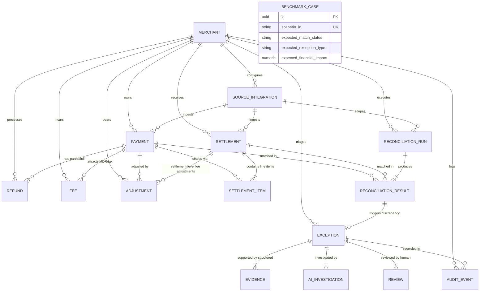

# ReconPilot — PostgreSQL Financial Data Architecture & Models

## 1. Entity-Relationship Overview

ReconPilot models the financial operations lifecycle from merchant configuration to evidence-backed dispute review and benchmark evaluation.



---

## 2. Model Responsibilities & Schema Map

| Table Name | Entity Class | Responsibility | Primary Key | Key Foreign Keys |
| :--- | :--- | :--- | :--- | :--- |
| `merchants` | `Merchant` | Tenant identity, billing currency (`INR`), timezone, status. | UUID | None |
| `source_integrations`| `SourceIntegration` | Merchant payment channels (`RAZORPAY`, `BANK_FEED`, `CSV_UPLOAD`). | UUID | `merchant_id` |
| `payments` | `Payment` | Normalized ledger of captured, authorized, refunded, or failed charges. | UUID | `merchant_id`, `source_integration_id` |
| `refunds` | `Refund` | Partial or multiple refund transactions linked to captured payments. | UUID | `merchant_id`, `payment_id` |
| `fees` | `Fee` | MDR, interchange, gateway fees, and GST tax broken down distinctly. | UUID | `merchant_id`, `payment_id` |
| `settlements` | `Settlement` | Gateway/bank payout batches with batch dates and total settled amounts. | UUID | `merchant_id`, `source_integration_id` |
| `settlement_items` | `SettlementItem` | Line-item ledger breakdown within settlement batches (gross, fee, refund, net). Nullable `payment_id` permits representing missing payments. | UUID | `merchant_id`, `settlement_id`, `payment_id` (nullable) |
| `adjustments` | `Adjustment` | Signed manual/chargeback credits or debits. | UUID | `merchant_id`, `payment_id` (nullable), `settlement_id` (nullable) |
| `reconciliation_runs`| `ReconciliationRun` | Batch reconciliation job metrics, status, duration, and parameter snapshots. | UUID | `merchant_id`, `source_integration_id` (nullable) |
| `reconciliation_results`| `ReconciliationResult` | 2-way/3-way matching record between payments and settlements with tolerance & confidence. | UUID | `run_id`, `merchant_id`, `payment_id` (nullable), `settlement_id` (nullable) |
| `exceptions` | `ExceptionRecord` | Discrepancy case files (fee mismatch, timing lag, missing payout) with severity scoring. | UUID | `merchant_id`, `reconciliation_result_id` (UK) |
| `evidence` | `Evidence` | Structured JSON snapshots of ledger, gateway, and contractual fee schedules supporting exceptions. | UUID | `exception_id` |
| `ai_investigations` | `AIInvestigation` | Bounded LLM investigative hypothesis, root cause, confidence score ($\ge 0.90$), and action recommendations. | UUID | `exception_id` |
| `reviews` | `Review` | Human controller audit approvals, overrides, and comments over time. | UUID | `exception_id` |
| `audit_events` | `AuditEvent` | Append-only ledger of actor operations (`SYSTEM`, `AI_AGENT`, `HUMAN_CONTROLLER`, `AUDITOR`). | UUID | `merchant_id`, `exception_id` (nullable), `reconciliation_run_id` (nullable) |
| `benchmark_cases` | `BenchmarkCase` | Ground-truth curated test scenarios for objective evaluation and scoring. Independent of system predictions. | UUID | None |

---

## 3. Financial Integrity & Conventions

### 3.1 Monetary Precision
- Database Type: PostgreSQL `NUMERIC(20, 2)` (enforced on all financial amounts).
- Python Type: Python `decimal.Decimal` (never floating-point `float` or string).
- Confidence Scores: Stored as `NUMERIC(5, 4)` with check constraint `confidence >= 0.0 AND confidence <= 1.0`.

### 3.2 Explicit Currency
- Stored as ISO 4217 three-letter string (`INR`, `USD`).
- Enforced via database check constraints `length(currency) = 3`.
- Cross-currency transactions are flagged and never silently combined.

### 3.3 Signed Adjustment Convention
A single mathematical convention governs expected settlement across the entire platform:
$$\text{Expected Settlement} = \text{Payment Gross Amount} - \text{Successful Refunds} - \text{Applicable Fees} + \text{Signed Adjustments}$$
- **Positive Adjustment ($+\Delta$):** Increases settlement amount owed to merchant (e.g. dispute won, goodwill credit, fee waiver).
- **Negative Adjustment ($-\Delta$):** Decreases settlement amount owed to merchant (e.g. chargeback loss, penalty debit).

### 3.4 Non-Destructive Referential Integrity
- Financial history tables (`payments`, `refunds`, `fees`, `settlements`, `adjustments`) enforce `ondelete="RESTRICT"` against `merchants`.
- A merchant cannot be accidentally deleted if financial history exists.
- Ingestion is idempotent: composite unique constraints `(merchant_id, external_id)` prevent duplicate ingestion.
- Settlement items allow nullable `payment_id`, enabling representation of rogue gateway charges without crashing referential integrity.

---

## 4. Seeding & CLI Workflow

### 4.1 Deterministic Demo Dataset
The dataset generator (`server/app/db/seed_data.py`) constructs a reproducible financial universe:
- **259 Payments** (card, UPI, net banking)
- **63 Settlements** across 20+ payout batches
- **258 Settlement Line Items**
- **258 Fees** with distinct tax breakdown
- **4 Refunds** and **6 Signed Adjustments**
- **50 Ground-Truth Benchmark Cases** covering every key reconciliation edge condition

### 4.2 Seed CLI Commands
```bash
# Idempotently seed the development database:
python -m app.db.seed

# Safely reset development tables (strictly rejected if APP_ENV=production):
python -m app.db.seed --reset --confirm-destructive
```

---

## 5. Migration Workflow

Alembic migrations are configured under `server/alembic/`:
```bash
# Preview offline SQL migration:
alembic upgrade head --sql

# Apply live migrations to PostgreSQL:
alembic upgrade head

# Rollback initial migration:
alembic downgrade -1
```
Initial migration file: [`server/alembic/versions/e925c743c42e_create_initial_financial_schema.py`](file:///d:/NANDAN.S/ENGINEERING/INTERNSHIP/MC_RAZOR/server/alembic/versions/e925c743c42e_create_initial_financial_schema.py)
